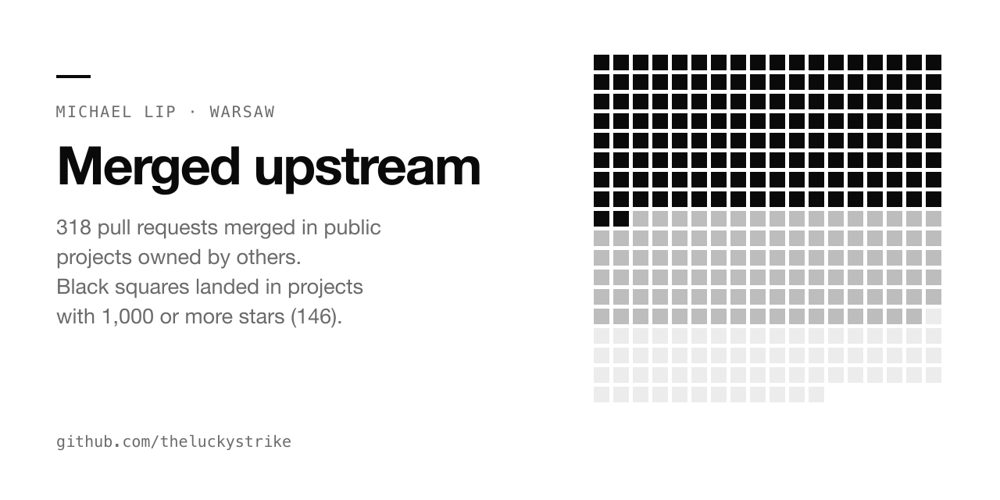

# Merged upstream



Pull requests I wrote that maintainers of other people's projects merged. It's the public record behind my client work at [axdale.com](https://www.axdale.com). I am Michael Lip, an engineer in Warsaw, Poland. I fix and secure AI agents and the systems around them.

## The numbers

| Measure | Count | How to check |
|---|---|---|
| Merged pull requests in public repos I do not own | 318 | [GitHub search](https://github.com/search?q=is%3Apr+is%3Amerged+author%3Atheluckystrike+-user%3Atheluckystrike&type=pullrequests) |
| Distinct public repos | 212 | Same search, grouped by repo |
| Owners that are GitHub organizations | 103 | Owner type from the GitHub API |
| Code pull requests into projects with 1,000+ stars | 146 | Excludes list and registry entries |
| Merged in October 2026 | 200 | Same search, by close date |

The counts cover public repos only. Private client work is not in them. Additions to awesome lists and package registries (67 of them) are left out of the code count.

## Selected work

Picked for what a CTO would want to see. Stars are the upstream project's count on 27 October 2026.

### Reliability, retries and clean shutdown

| Project | Stars | Change | Merged |
|---|---:|---|---|
| [urllib3/urllib3](https://github.com/urllib3/urllib3) | 4,080 | [Honor Retry-After on PoolManager redirects](https://github.com/urllib3/urllib3/pull/5330) | 2026-10-21 |
| [hookdeck/outpost](https://github.com/hookdeck/outpost) | 1,073 | [fix(deliverymq): nack when the attempt log is not published](https://github.com/hookdeck/outpost/pull/1134) | 2026-10-13 |
| [dagucloud/dagu](https://github.com/dagucloud/dagu) | 4,454 | [fix(worker): stop gracefully on SIGINT and SIGTERM](https://github.com/dagucloud/dagu/pull/3035) | 2026-10-07 |
| [dagucloud/dagu](https://github.com/dagucloud/dagu) | 4,454 | [feat(worker): bound the shutdown drain with worker.shutdown_timeout](https://github.com/dagucloud/dagu/pull/3062) | 2026-10-08 |
| [clastix/kamaji](https://github.com/clastix/kamaji) | 2,062 | [fix(konnectivity): guard ShouldStatusBeUpdated against a nil Konnectivity spec](https://github.com/clastix/kamaji/pull/1342) | 2026-10-10 |

### Security and input validation

| Project | Stars | Change | Merged |
|---|---:|---|---|
| [PrefectHQ/prefect](https://github.com/PrefectHQ/prefect) | 24,082 | [hardening: validate PEP 508 deps in execute_bundle_in_subprocess](https://github.com/PrefectHQ/prefect/pull/21916) | 2026-05-18 |
| [janbjorge/pgqueuer](https://github.com/janbjorge/pgqueuer) | 1,546 | [fix(settings): validate DBSettings object names before they reach SQL](https://github.com/janbjorge/pgqueuer/pull/946) | 2026-10-11 |
| [mercurjs/mercur](https://github.com/mercurjs/mercur) | 1,868 | [fix(core): honour AUTHENTICATE = false on compiled vendor routes](https://github.com/mercurjs/mercur/pull/1613) | 2026-10-05 |
| [OpnForm/OpnForm](https://github.com/OpnForm/OpnForm) | 3,868 | [Fix export status API docs and secure token polling](https://github.com/OpnForm/OpnForm/pull/1314) | 2026-10-07 |
| [intuitem/ciso-assistant-community](https://github.com/intuitem/ciso-assistant-community) | 4,544 | [fix(backend): return sso info when settings have no saml sp section](https://github.com/intuitem/ciso-assistant-community/pull/4992) | 2026-10-14 |
| [Nano-Collective/nanocoder](https://github.com/Nano-Collective/nanocoder) | 2,535 | [test(list-directory): regression tests for out-of-root absolute path containment](https://github.com/Nano-Collective/nanocoder/pull/1540) | 2026-10-15 |
| [zenstackhq/zenstack](https://github.com/zenstackhq/zenstack) | 2,954 | [fix(policy): compare `before()` enum fields as text on PostgreSQL](https://github.com/zenstackhq/zenstack/pull/2869) | 2026-10-23 |

### Agent and LLM tooling

| Project | Stars | Change | Merged |
|---|---:|---|---|
| [Agent-Field/agentfield](https://github.com/Agent-Field/agentfield) | 2,624 | [fix(control-plane): write the executions row for legacy reasoner and skill calls](https://github.com/Agent-Field/agentfield/pull/1099) | 2026-10-15 |
| [hkjarral/AVA-AI-Voice-Agent-for-Asterisk](https://github.com/hkjarral/AVA-AI-Voice-Agent-for-Asterisk) | 1,257 | [fix: prevent stale farewell hangups and preserve transfer recovery](https://github.com/hkjarral/AVA-AI-Voice-Agent-for-Asterisk/pull/735) | 2026-10-17 |
| [Mintplex-Labs/anything-llm](https://github.com/Mintplex-Labs/anything-llm) | 67,603 | [fix: don't treat YouTube channel URLs as video links in the collector](https://github.com/Mintplex-Labs/anything-llm/pull/6644) | 2026-10-06 |
| [a-ghorbani/pocketpal-ai](https://github.com/a-ghorbani/pocketpal-ai) | 8,824 | [fix(chat): clamp effort to model-supported levels](https://github.com/a-ghorbani/pocketpal-ai/pull/1002) | 2026-10-24 |

### Developer tooling

| Project | Stars | Change | Merged |
|---|---:|---|---|
| [remotion-dev/remotion](https://github.com/remotion-dev/remotion) | 67,942 | [`@remotion/renderer`: Accept uppercase output file extensions](https://github.com/remotion-dev/remotion/pull/12020) | 2026-10-06 |
| [appium/appium](https://github.com/appium/appium) | 22,137 | [fix(universal-xml-plugin): keep the enabled attribute in transformed source](https://github.com/appium/appium/pull/22911) | 2026-10-08 |
| [boyter/scc](https://github.com/boyter/scc) | 8,848 | [fix(history): walk only the first-parent commit chain (#783)](https://github.com/boyter/scc/pull/791) | 2026-10-18 |
| [scalar/scalar](https://github.com/scalar/scalar) | 16,323 | [fix(snippetz): escape quotes and backslashes in R httr2 code examples](https://github.com/scalar/scalar/pull/10492) | 2026-10-06 |
| [thomhurst/TUnit](https://github.com/thomhurst/TUnit) | 3,980 | [fix(engine): use last inferred type for repeated generic parameters](https://github.com/thomhurst/TUnit/pull/7134) | 2026-10-19 |
| [cloudposse/atmos](https://github.com/cloudposse/atmos) | 1,407 | [fix(stacks): let !unset remove a whole component section](https://github.com/cloudposse/atmos/pull/3289) | 2026-10-18 |
| [gumyr/build123d](https://github.com/gumyr/build123d) | 3,535 | [Close the XCAF document created by each STEP and glTF export](https://github.com/gumyr/build123d/pull/1526) | 2026-10-19 |
| [GoogleChrome/chrome-extensions-samples](https://github.com/GoogleChrome/chrome-extensions-samples) | 17,826 | [feat: add chrome.commands API sample](https://github.com/GoogleChrome/chrome-extensions-samples/pull/1629) | 2026-03-04 |

## Read the reviews

Every row links to the pull request. You can read the diff, the review thread and the maintainer's own words. That is the point of this page. Judge the work, not my summary of it.

## Rebuild this page

`build.py` reads the live GitHub search and rewrites `docs/data.json` and `docs/index.html`. It needs the `gh` CLI, logged in.

```sh
python3 build.py
```

## Work with me

Send your project at [axdale.com](https://www.axdale.com/start/?src=gh). Share as much context as you can, such as the repo, the scope, the files and the deadline. I work async, in writing. The written plan is free, the first milestone is paid only if you accept it, and the rate is USD 65 per hour.

Michael
